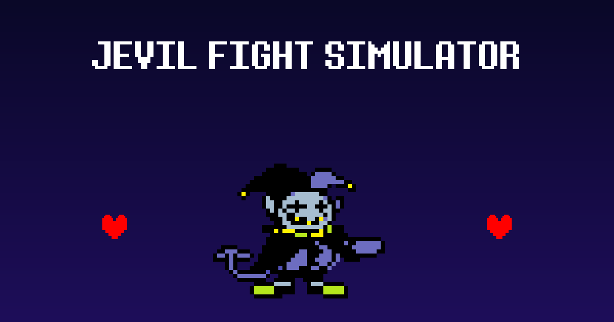

# Jevil Fight Simulator

**▶ Play now: https://bautipro67.github.io/jevil-fight-simulator/**

Play the Jevil boss fight from **DELTARUNE Chapter 1** for free in your browser, on PC or mobile. No download needed.



- Fight with Kris, Susie and Ralsei: FIGHT, ACT (Check, Pirouette, Hypnosis), MAGIC, ITEM, SPARE and DEFEND.
- All 16 of Jevil's attacks plus the Final Chaos, with the SOUL, grazing and TP.
- The battle logic is ported from the original game, so it plays like the real fight.
- **Practice mode** (Bad Time Simulator style): dodge the 16 attacks in order; lose your HP bar and the attack restarts, survive it and you move on. Pick the starting attack and 90 / 45 / 1 HP. Scores with ranks and a saved best for full runs. Direct link: [`?practice`](https://bautipro67.github.io/jevil-fight-simulator/?practice).
- **EQUIPMENT**: pick each character's weapon and two armors (any Chapter 1 gear they can use) and the items for the fight. Saved in the browser.
- **Easy Mode** (title screen → OPTIONS) halves the damage you take.
- **OPTIONS**: volume, **SOUL hats** and **CONTROLS** to remap every button on keyboard and gamepad. Options are remembered in the browser.
- **Sandbox mode** to repeat any attack freely: [`?sandbox&attack=0`](https://bautipro67.github.io/jevil-fight-simulator/?sandbox&attack=0) (`[` / `]` switch attacks, `I` invincibility).
- Touch controls on phones and tablets.

## Controls

| Key | Action |
|---|---|
| Z / Enter | Confirm |
| X / Shift | Cancel |
| Arrow keys | Move |
| Esc / P | Pause (restart, volume, quit to title) |

**Gamepad** (Xbox, PlayStation, Switch): A / Cross confirms, B / Circle cancels, D-pad or left stick moves, Start pauses. Browsers only turn on sound after a click or key press, so click the page once.

## Run it locally

```
python -m http.server 8000
```

Then open `http://localhost:8000`.

## How it was made

- `tools/datawin.py` reads GameMaker `data.win` files (sprites, fonts, sounds).
- `tools/gmdis.py` decompiles the game's bytecode so the fight could be studied.
- `tools/extract_assets.py` extracts only the assets this fight uses into `assets/`.
- `src/runtime/` is a small GameMaker-like engine in JavaScript; `src/battle/` and `src/jevil/` are the ported fight.

## Credits

DELTARUNE and all its characters, graphics, music and sounds are © Toby Fox. This is a free, non-commercial fan project, not affiliated with Toby Fox or 8-4. If you enjoy it, get the real game: https://deltarune.com

---

*Simulador de la pelea contra Jevil de DELTARUNE, jugable gratis en el navegador.*
